# Báo cáo kết quả thực nghiệm SimpleDyG

**Cập nhật:** 05/11/2026, bản cuối (thay các bản 02/11 và 04/11/2026)
**Nhóm 6:** Vũ Duy Thụ & Đỗ Quốc Thịnh
**Paper gốc:** Wu, Fang, Liao – *On the Feasibility of Simple Transformer for Dynamic Graph Modeling* (WWW '24), [arXiv:2401.14009](https://arxiv.org/abs/2401.14009v2)

**Nguồn kết quả:**

| Đợt chạy | Nội dung | Thư mục |
|---|---|---|
| Đợt 1 | 100 lượt: UCI + ML-10M × (SimpleDyG full / same_time / no_time, TGAT, GraphMixer) × 10 seed | `results/round1_100runs/`, `notebooks/SimpleDyG_Previous_Results.zip` |
| Đợt 2 | 10 lượt: UCI, SimpleDyG `per_ego_permute` × 10 seed | `results/round2_uci_permute/` |
| Đợt 3 | 15 lượt: ML-10M, protocol `corrected`, 3 biến thể × 5 seed | `results/round3_ml_corrected/` |

**Slide:** [`SimpleDyG_Slide_KetQua.pdf`](SimpleDyG_Slide_KetQua.pdf) (29 trang). Slide 1–12 và 29 (Thank you) là slide giữa kỳ. Slide 13–28 trình bày thiết lập, dữ liệu, chi phí, kết quả, đường học, temporal alignment, phân tích bổ sung, tổng kết và nhận xét.

## 1. Tóm tắt

- **Đã chạy xong 125/125 lượt** trên 2×Tesla T4 (Kaggle), không có lượt lỗi.
- **Tái lập được trên UCI.** SimpleDyG full đạt NDCG@5 .1045 ± .017 và Jaccard .0875 ± .013, so với paper .104 ± .010 / .092 ± .014. SimpleDyG vẫn tốt nhất trong ba mô hình đã chạy (TGAT .049, GraphMixer .070).
- **ML-10M không tái lập được: mô hình suy biến.** Gần như mọi lượt chỉ dự đoán phim `1419` (đích phổ biến nhất) cho hầu hết user, hoặc không sinh ra dự đoán nào. Nếu luôn đoán `1419`, ta được NDCG@5 .1475 / Jaccard .1397; đây là trần của mọi lượt SimpleDyG và GraphMixer. Số paper báo cho ML-10M same_time (.147 ± .001) gần như trùng với mức này.
- **Thử khắc phục ML-10M bằng mask padding (protocol `corrected`).**
  - Mô hình học sớm hơn, và biến thể full ổn định hơn (std .061 → .011).
  - Nhưng 14/15 lượt vẫn suy biến và không lượt nào vượt baseline phổ biến.
  - Kết luận: dưới cấu hình paper (2 lớp, dim 128, lr 1e-5), ML-10M bị chi phối bởi độ phổ biến.
- **Một heuristic không cần huấn luyện mạnh hơn mọi mô hình trên UCI.** Chỉ cần lặp lại các node của time slot gần nhất mà user có hoạt động, ta được NDCG@5 .293, gấp khoảng 2,8 lần SimpleDyG.
- **Temporal alignment không có hiệu ứng đo được trên UCI.** So theo cặp cùng seed, cả ba biến thể same_time, no_time và `per_ego_permute` đều có khoảng tin cậy 95% của ΔNDCG chứa 0. Biến thể `per_ego_permute` phá riêng phần căn chỉnh thời gian giữa các ego, và cũng không làm kết quả kém đi một cách có ý nghĩa.
- **Đối chiếu yêu cầu của GV:** đạt cả ba yêu cầu (mục 8). Riêng ML-10M, phần reproduce được thay bằng phân tích và chẩn đoán nguyên nhân sai lệch.

## 2. Phạm vi và kiểm tra gói kết quả

| Hạng mục | Kết quả kiểm tra |
|---|---|
| Cấu hình chính | profile `paper`, protocol `author_compat` (giữ hành vi mã gốc); epochs 100, patience 10, context 1024, train_block 512 |
| Cấu hình chẩn đoán | protocol `corrected` (mask padding trong loss, attention mask, dừng sinh ở `<|endofpre|>`), patience 20; chỉ chạy trên ML-10M |
| Dataset | UCI (1.781 node, 16.743 cạnh), ML-10M (15.841 node, 48.561 cạnh); 13 time step mỗi dataset |
| Split (train / val / test, số truy vấn) | UCI 1.708 / 146 / 110; ML-10M 13.701 / 738 / 396 |
| Cắt chuỗi | UCI: không có. ML-10M: 12 chuỗi train > 512 token; 3 truy vấn val và 2 test > 1.024 token |
| Mô hình | SimpleDyG (kiến trúc GPT-2 của tác giả); TGAT và GraphMixer (DyGLib + adapter BPR, chọn dim ∈ {16…512} theo validation) |
| Biến thể temporal token | full, same_time, no_time, per_ego_permute |
| Seed | 0–9 (ML-10M corrected: 0–4) |
| Môi trường | Python 3.13.15, PyTorch 2.11.0+cu128, CUDA 12.8, 2×T4; runtime `kaggle_pipeline_dual.py` SHA-256 `e6e61428…` dùng chung cho cả ba đợt |

Cờ `resume_source_alignment.json: "aligned": false` **không phải lỗi**. Code chỉ bật cờ khi phải dựng lại thư mục nguồn theo manifest; lần chạy này 12/12 file nguồn đã khớp ngay nên không cần dựng lại.

### 2.1 Phân bố dữ liệu theo thời gian

| Dataset | Tương tác mỗi time step (train) | Validation (step 11) | Test (step 12) |
|---|---|---|---|
| UCI | 1.593–3.653 ở step 0–4, giảm còn 244–547 ở step 6–10 | 241 tương tác · 146 user | 197 tương tác · 110 user |
| ML-10M | 2.805–4.039 phần lớn các step, đỉnh 8.479 (step 0) và 6.614 (step 6) | 2.227 tương tác · 738 user | 991 tương tác · 396 user |

- **UCI thưa dần theo thời gian.** Tập test chỉ có 110 user hoạt động, nên điểm dao động đáng kể giữa các seed: std .017, khoảng 16% giá trị trung bình.
- **Paper dùng chính hình này (Hình A.1)** để lập luận rằng UCI và ML-10M có thay đổi đột ngột giữa các slot nên cần temporal alignment. Mục 7 kiểm tra lại lập luận này.

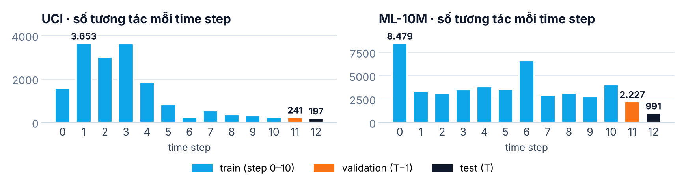

### 2.2 Chi tiết huấn luyện

| Thành phần | Thiết lập |
|---|---|
| SimpleDyG · UCI | 6 lớp, 8 head, dim 768, batch 32, lr 1e-4 (44,7 triệu tham số) |
| SimpleDyG · ML-10M | 2 lớp, 4 head, dim 128, batch 64, lr 1e-5 (2,6 triệu tham số) |
| Tối ưu | AdamW của tác giả, lr giảm tuyến tính, tối đa 100 epoch; early stopping theo NDCG@5 validation (patience 10; corrected: 20) |
| Chuỗi | Train ≤ 512 token, context 1.024; micro-batch 8 + gradient accumulation, giữ nguyên batch logic |
| Dự đoán | Greedy decoding đến token kết thúc |
| TGAT / GraphMixer | DyGLib, loss BPR, feature nút/cạnh = 0, batch 128; TGAT 20 neighbour, GraphMixer 1.024 token lịch sử; chọn dim ∈ {16, 32, 64, 128, 256, 512} theo validation (6 lần huấn luyện mỗi seed) |

### 2.3 Chi phí tính toán

GPU-giờ dưới đây là tổng thời gian huấn luyện và test ghi trong log, gồm cả bước decode validation sau mỗi epoch. Thời gian trên 2×T4 bằng GPU-giờ chia 2, chưa tính thời gian cài đặt và nạp lại checkpoint giữa các phiên.

| Đợt | Nội dung | Lượt | GPU-giờ | Thời gian trên 2×T4 |
|---|---|---:|---:|---:|
| 1 | 2 dataset × 5 cấu hình × 10 seed | 100 | 670 | ≈ 335 giờ |
| 2 | UCI per_ego_permute × 10 seed | 10 | 6,4 | ≈ 3,2 giờ |
| 3 | ML-10M corrected, 3 biến thể × 5 seed | 15 | 12,6 | ≈ 6,5 giờ |
| **Tổng** | | **125** | **≈ 689** | **≈ 345 giờ** |

| Mô hình · dataset | GPU-giờ | Giờ / lượt | Giây / epoch |
|---|---:|---:|---:|
| GraphMixer · ML-10M | 424 | 42,4 | 1.376 |
| TGAT · ML-10M | 108 | 10,8 | 287 |
| GraphMixer · UCI | 76 | 7,6 | 259 |
| SimpleDyG · ML-10M (cả hai protocol) | 44 | 0,4–1,3 | 42–215 |
| SimpleDyG · UCI (4 biến thể) | 22 | 0,5–0,6 | 44–48 |
| TGAT · UCI | 16 | 1,6 | 67 |

- **SimpleDyG chỉ chiếm chưa tới 10%** tổng GPU-giờ (≈ 66/689). Phần lớn chi phí đến từ việc chọn dimension cho baseline: 6 lần huấn luyện mỗi seed. Riêng GraphMixer ML-10M ở dim 512 mất 24,5 giờ mỗi seed (dim 16 chỉ mất 1,8 giờ), trong khi điểm validation không tốt hơn rõ rệt (phụ lục B).
- **Thời gian mỗi epoch của baseline** cộng dồn mọi dimension ứng viên. Số của paper (Table 5, trên L40) chỉ đo phần huấn luyện, nên chỉ so được tương đối.
- **SimpleDyG ML-10M same_time (corrected) mất 215 giây/epoch**, vì mô hình không sinh được token kết thúc và mỗi truy vấn phải decode đủ 64 token.

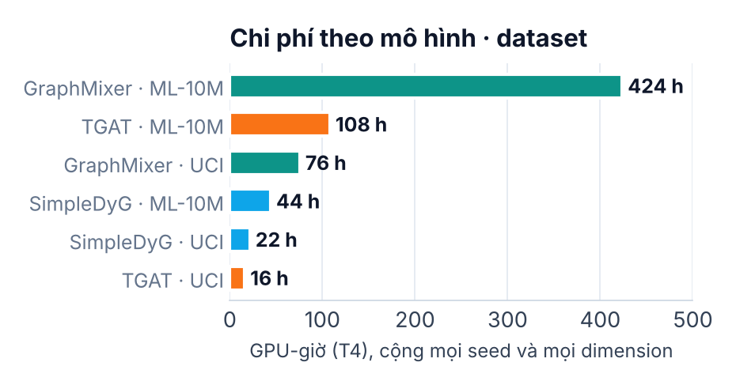

## 3. Reproduce link prediction trên UCI

Các số là mean ± std trên 10 seed.
- **NDCG chuẩn** khử trùng lặp trong dự đoán và nhãn, là metric chính của báo cáo.
- **NDCG tác giả** giữ trùng lặp như mã gốc (có thể > 1); chỉ dùng khi đối chiếu với paper.

| Biến thể | NDCG@5 chuẩn | NDCG@5 tác giả | Paper NDCG@5 | Jaccard | Paper Jaccard |
|---|---:|---:|---:|---:|---:|
| full | .1045 ± .0169 | .1118 ± .0114 | .104 ± .010 | .0875 ± .0132 | .092 ± .014 |
| same_time | .1037 ± .0170 | .1073 ± .0178 | .090 ± .013 | .0919 ± .0140 | .083 ± .012 |
| no_time | .1092 ± .0108 | .1151 ± .0162 | .111 ± .015 | .0932 ± .0113 | .091 ± .014 |
| per_ego_permute | .0974 ± .0218 | .0991 | – | .0846 ± .0190 | – |

Mọi biến thể của paper đều nằm trong khoảng ±1 std của paper; riêng same_time cao hơn paper. Dự đoán trên UCI có tính **cá nhân hóa**: mỗi lượt có 63–96 tập dự đoán khác nhau trên 110 truy vấn test, và tập phổ biến nhất chiếm không quá 16,4%.

### So với baseline (Table 2)

| Tập · Metric | TGAT | Paper | GraphMixer | Paper | **SimpleDyG** | Paper |
|---|---:|---:|---:|---:|---:|---:|
| UCI · NDCG@5 | .049 ± .024 | .061 | .070 ± .017 | .104 | **.104 ± .017** | .104 |
| UCI · Jaccard | .028 ± .013 | .020 | .034 ± .009 | .042 | **.087 ± .013** | .092 |
| ML-10M · NDCG@5 | .009 ± .014 | .066 | .152 ± .046 | .081 | .099 ± .061 | .138 |
| ML-10M · Jaccard | .005 ± .006 | .021 | .086 ± .046 | .043 | .093 ± .057 | .131 |

Cách tính Jaccard theo paper: với baseline, lấy giá trị lớn nhất theo k ∈ {1, 5, 10, 20} trên tập test (mang tính oracle); với SimpleDyG, dùng tập node mà mô hình sinh ra. Các số ML-10M trong bảng thuộc protocol `author_compat`.

Lưu ý: bảng `table2_performance.csv` do notebook ML sinh ra đã gộp hai protocol `author_compat` và `corrected`, cho số ML-10M SimpleDyG là .106. Báo cáo này tách riêng hai protocol, dùng .099 cho `author_compat` và trình bày `corrected` ở mục 4.4.

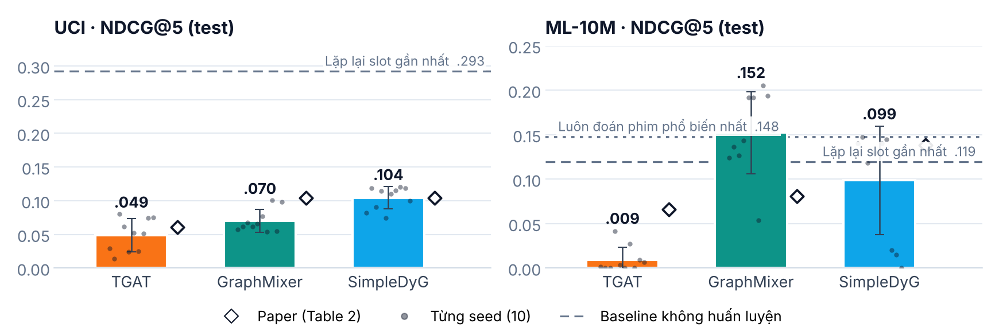

## 4. ML-10M: mô hình suy biến về dự đoán phổ biến

### 4.1 Bằng chứng

Mình đếm, trong mỗi lượt, tỷ lệ truy vấn test nhận cùng một tập dự đoán. Một lượt bị coi là **suy biến** khi tỷ lệ này ≥ 70%.

| Protocol · Biến thể | Tỷ lệ truy vấn nhận cùng một dự đoán | Số tập dự đoán khác nhau (/396) | Số lượt suy biến |
|---|---|---|---|
| author_compat · full | 74,7–98,5% | 3–7 | 10/10 (7 đoán `1419`, 2 đoán `9048`, 1 rỗng) |
| author_compat · same_time | 98,0–99,7% | 2–9 | 10/10 (8 đoán `1419`, 2 rỗng) |
| author_compat · no_time | 98,5–99,7% | 2–6 | 10/10 (8 đoán `1419`, 2 rỗng) |
| corrected · full | 68,4–80,6% | 3–8 | 4/5 (đoán `1419`) |
| corrected · same_time | 100% | 1 | 5/5 (rỗng) |
| corrected · no_time | 93,2–99,7% | 2–7 | 5/5 (4 đoán `1419`, 1 rỗng) |

- Phim `1419` là đích xuất hiện nhiều nhất trong train (1.417 lần) và nằm trong ground truth của 17,7% user test.
- Có 15 lượt `author_compat` và 4 lượt `corrected` đạt **đúng** .1475 / .1397, tức trùng hoàn toàn với baseline "luôn đoán 1419".
- Các lượt "rỗng" không bao giờ sinh token kết thúc, nên không có dự đoán nào và điểm bằng 0.

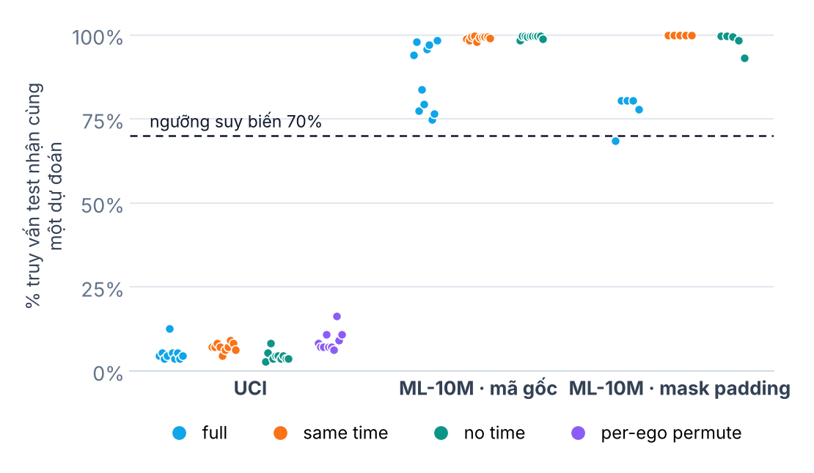

### 4.2 Nguyên nhân giả định

1. **Loss tính cả trên padding.** Protocol `author_compat` giữ đúng mã gốc: không mask padding và không dùng attention mask. Chuỗi ML-10M được pad tới 512 token, nên phần lớn loss đến từ việc dự đoán `[PAD]`.
2. **Learning rate nhỏ.** ML-10M dùng lr 1e-5, mô hình 2 lớp, dim 128 (theo script tác giả). Với `author_compat`, NDCG validation bằng 0 suốt khoảng 20 epoch đầu.
3. **Early stopping quá sớm.** Với `patience=10`, các seed chưa vượt được mức 0 sẽ dừng ở epoch 11–12. Ngoài ra, `author_compat` coi điểm bằng nhau là cải thiện (`>=`), nên các lượt đã kẹt ở mức phổ biến (val .0955) vẫn chạy tiếp đến epoch 100.

### 4.3 Liên hệ với paper

Paper báo ML-10M same_time = **.147 ± .001 / .139 ± .001**. Con số này trùng với baseline "luôn đoán 1419" (.1475 / .1397), và độ lệch chuẩn gần như bằng 0, rất khó xảy ra nếu mô hình thật sự học được dự đoán theo từng user. Nhiều khả năng chính kết quả của paper cũng là trạng thái suy biến này. Đây là suy luận từ số liệu, chưa được kiểm chứng trực tiếp.

### 4.4 Thử khắc phục: protocol `corrected` (đợt 3)

Thiết lập: mask padding trong loss, attention mask, `patience=20`; 3 biến thể × 5 seed.

| Biến thể | author_compat (10 seed) | corrected (5 seed) | Lượt suy biến (corrected) | Epoch tốt nhất (corrected) |
|---|---:|---:|---|---:|
| full | .099 ± .061 | **.120 ± .011** | 4/5 | 47,6 |
| same_time | .118 ± .062 | .000 ± .000 | 5/5 (rỗng) | 1 |
| no_time | .118 ± .062 | .118 ± .066 | 5/5 | 13,8 |
| *Luôn đoán `1419`* | *.1475* | *.1475* | | |

**Kết quả:**
- **Mô hình bắt đầu học sớm hơn, nhưng mức cải thiện khác nhau giữa các biến thể.** Lấy mốc là epoch đầu tiên NDCG validation ≥ .01 (trung vị):
  - no_time: epoch **4**, so với 22,5 khi dùng `author_compat`;
  - full: epoch 20 (khoảng 8–22), so với 25;
  - same_time: không bao giờ đạt mốc này.
- **full ổn định hơn.** Không còn seed nào bằng 0, và std giảm từ .061 xuống .011. Mức .120 vẫn thấp hơn baseline phổ biến, và 4/5 lượt vẫn đoán `1419` cho khoảng 78–81% user.
- **no_time** vẫn hội tụ về đúng mức phổ biến (4/5 seed đạt .1475).
- **same_time** thất bại hoàn toàn: mô hình không sinh được token kết thúc, NDCG validation bằng 0 suốt 20 epoch nên dừng ở epoch 21. Thời gian mỗi epoch cũng tăng lên khoảng 215 giây, vì mỗi truy vấn phải sinh đủ 64 token.

**Kết luận:** loss tính trên padding làm việc học chậm lại và tăng độ dao động giữa seed, nhưng **không phải nguyên nhân chính** của suy biến. Với cấu hình mô hình của paper, ML-10M bị chi phối bởi độ phổ biến, nên không dùng được để kết luận về temporal alignment. Kết quả `corrected` chỉ dùng để chẩn đoán, không so trực tiếp với số của paper.

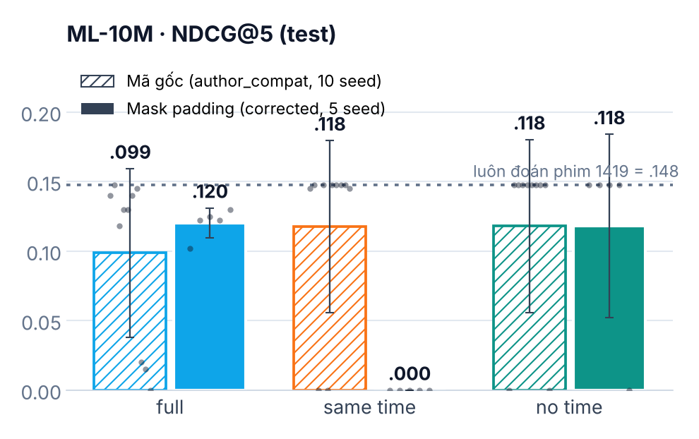

### 4.5 Đường học trên tập validation

Hình dưới vẽ NDCG@5 trên tập validation sau mỗi epoch: đường mảnh là từng seed, đường đậm là trung vị. Nét đứt là điểm của "luôn đoán phim 1419" trên validation (.0955).

- **UCI (mã gốc):** điểm tăng đều từ khoảng epoch 4 rồi bão hòa ở .15–.18. Ba biến thể gần như chồng lên nhau, tức là mô hình học bình thường.
- **ML-10M (mã gốc):** điểm bằng 0 suốt khoảng 22–25 epoch, rồi nhảy lên đúng .0955 và đứng yên. Có 20/30 lượt chạm đúng mức này trên validation. Với biến thể full, sau khi đạt đỉnh mô hình thường rời khỏi đáp án phổ biến nhưng tụt xuống còn khoảng .03. Early stopping giữ lại checkpoint ở đỉnh, nên điểm test của full dao động mạnh giữa các seed.
- **ML-10M (mask padding):** no_time học từ epoch 4 nhưng vẫn dừng ở .0955. same_time bằng 0 suốt 21 epoch rồi dừng. Chỉ 2 seed full chạy đủ 100 epoch, đạt khoảng .08–.09 trên validation.

Như vậy, suy biến đã xuất hiện ngay trong lúc huấn luyện, chứ không chỉ khi đánh giá trên tập test.

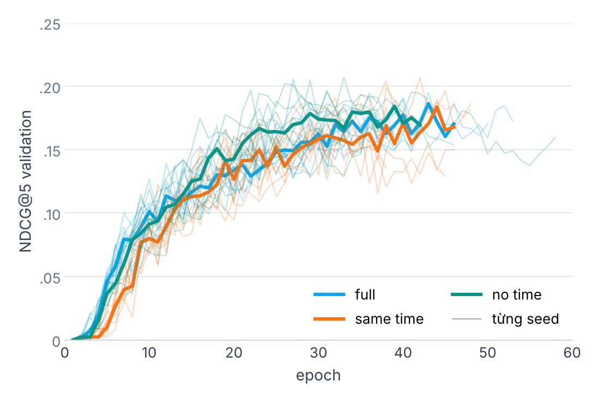

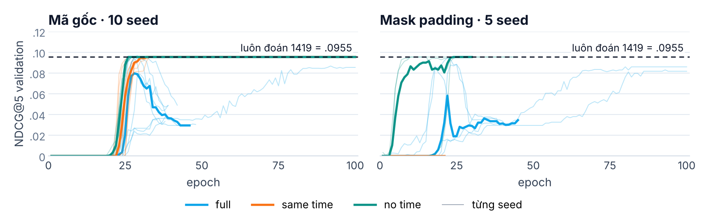

## 5. Baseline không huấn luyện

Các heuristic dưới đây dùng cùng metric với pipeline, và chỉ đọc lịch sử đầu vào của truy vấn cùng tập train (không đọc nhãn test).

| Phương pháp (test) | UCI NDCG@5 | UCI Jaccard | ML-10M NDCG@5 | ML-10M Jaccard |
|---|---:|---:|---:|---:|
| SimpleDyG full | .1045 | .0875 | .0986 | .0932 |
| Đích phổ biến nhất trong train, top-1 | .0000 | .0000 | **.1475** | **.1397** |
| Đích phổ biến nhất trong train, top-5 | .0124 | .0079 | .1525 | .0350 |
| Lặp lại các node của time slot gần nhất có hoạt động | **.2928** | **.2526** | .1193 | .1046 |
| Neighbour thường gặp nhất của ego, top-1 | .0955 | .0892 | .0904 | .0822 |
| Neighbour thường gặp nhất của ego, top-5 | .1460 | .0470 | .1324 | .0422 |

Trên tập validation, xu hướng vẫn giữ nguyên: lặp lại slot gần nhất cho UCI .219 / .189. Hai nhận xét:

1. **UCI có tính lặp lại rất mạnh.** Người dùng nhắn lại đúng những người vừa nhắn ở slot trước. Paper không có baseline loại này.
2. **ML-10M bị chi phối bởi độ phổ biến.** Bảng xếp hạng mô hình trên ML-10M không có ý nghĩa nếu không đặt cạnh baseline này.

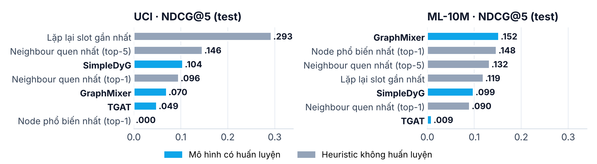

## 6. Baseline học sâu (TGAT, GraphMixer)

| Dataset | Model | NDCG@5 | Paper | Jaccard (k chọn trên val) | Jaccard oracle max-k | Ghi chú |
|---|---|---:|---:|---:|---:|---|
| UCI | TGAT | .0487 ± .0243 | .061 ± .007 | .0177 | .0280 | |
| UCI | GraphMixer | .0698 ± .0171 | .104 ± .013 | .0216 | .0344 | |
| ML-10M | TGAT | .0091 ± .0142 | .066 ± .035 | .0035 | .0047 | 3/10 seed có NDCG = 0 |
| ML-10M | GraphMixer | .1523 ± .0462 | .081 ± .033 | .0626 | .0864 | Luôn chọn k=1; 4/10 seed có Jaccard đúng .1397, tức là cũng đoán phim phổ biến |

Không nên đọc bảng này như một phép so sánh cùng giao thức với paper. Hai baseline ở đây là adapter BPR từ DyGLib, dùng feature bằng 0 và logical batch 128 (micro-batch 8); pipeline chỉ có 2 trong 8 baseline của paper. Kết quả "GraphMixer vượt paper trên ML-10M" chủ yếu đến từ việc mô hình xếp phim phổ biến lên đầu.

## 7. Vai trò của temporal alignment

**Các biến thể:**
- `same_time`: mọi time token được thay bằng `<|time0|>`. Chuỗi vẫn được chia theo slot nhưng các slot không còn được phân biệt.
- `no_time`: bỏ toàn bộ time token, chỉ còn thứ tự sự kiện.
- `per_ego_permute` (đợt 2): giữ nguyên cách chia slot của từng ego, nhưng hoán vị nhãn thời gian riêng cho từng ego, nhất quán giữa input và target. Nhờ đó chỉ có phần **căn chỉnh thời gian giữa các ego** bị phá.

Mỗi biến thể được so với `full` theo cặp cùng seed, dùng khoảng tin cậy 95% theo phân phối t và sign test.

| Dataset · Protocol | So sánh | ΔNDCG@5 [CI 95%] | ΔJaccard [CI 95%] | Tăng / giảm | p (sign test) |
|---|---|---|---|---|---:|
| UCI · author_compat | same_time − full | −.0008 [−.0162, +.0147] | +.0045 [−.0095, +.0184] | 6 / 4 | .75 |
| UCI · author_compat | no_time − full | +.0047 [−.0087, +.0181] | +.0057 [−.0049, +.0163] | 6 / 4 | .75 |
| UCI · author_compat | per_ego_permute − full | −.0070 [−.0285, +.0144] | −.0029 [−.0223, +.0165] | 5 / 5 | 1,00 |
| ML-10M · author_compat | same_time − full | +.0189 [−.0495, +.0874] | +.0180 [−.0464, +.0825] | 7 / 2 | .18 |
| ML-10M · author_compat | no_time − full | +.0194 [−.0345, +.0733] | +.0185 [−.0322, +.0693] | 7 / 1 | .07 |
| ML-10M · corrected | same_time − full | −.1202 [−.1336, −.1068] | −.1128 [−.1256, −.0999] | 0 / 5 | .06 |
| ML-10M · corrected | no_time − full | −.0022 [−.0915, +.0872] | −.0010 [−.0857, +.0837] | 4 / 1 | .38 |

Với NDCG cách tính của tác giả, `per_ego_permute − full` = −.0127 [−.0322, +.0068]. Khoảng tin cậy vẫn chứa 0.

**Kết luận:**
- **UCI:** không biến thể nào khác `full` có ý nghĩa thống kê. Thứ tự trung bình (no_time ≥ full ≥ same_time > per_ego_permute) cùng chiều với giả thuyết của paper, nhưng đều nằm trong nhiễu giữa các seed. Ngay cả khi phá hẳn căn chỉnh thời gian giữa các ego, NDCG chỉ giảm .007 và 5/10 seed vẫn tăng.
  - Như vậy, trên UCI, SimpleDyG **không khai thác được temporal alignment** theo cách đo được.
  - Điều này phù hợp với mục 5: tín hiệu mạnh nhất là tính lặp lại cục bộ của từng ego.
- **ML-10M:** phép so sánh không hợp lệ dưới cả hai protocol. Mọi biến thể đều suy biến, nên chênh lệch chỉ phản ánh số seed rơi vào "đoán phổ biến" hay "rỗng". Mức giảm có ý nghĩa của same_time (corrected) là do 5/5 lượt không sinh được dự đoán, không phải tác động của temporal token.
- **So với paper:** paper kết luận temporal alignment quan trọng với UCI và ML-10M. Kết quả của nhóm **không xác nhận** kết luận này, nhưng cũng chưa bác bỏ được. Với 10 seed, chỉ phát hiện được các hiệu ứng khoảng ≥ .015 NDCG trên UCI.

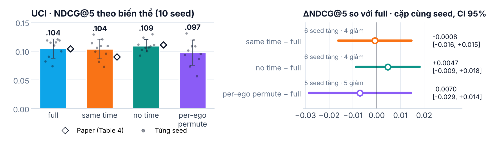

## 8. Đối chiếu với yêu cầu của GV

| Yêu cầu | Trạng thái | Căn cứ |
|---|---|---|
| Chạy 1–2 dataset đã preprocess | **Đạt** | UCI và ML-10M dùng đúng file preprocess của tác giả; data audit kiểm tra hash, split và khớp với đồ thị gốc (mục 2). |
| Reproduce link prediction / dynamic graph prediction | **Đạt trên UCI; ML-10M có giải thích** | UCI khớp paper (.104 so với .104), kèm TGAT, GraphMixer và baseline heuristic (mục 3, 5, 6). ML-10M lệch so với paper; đã xác định hiện tượng suy biến, thử khắc phục bằng protocol `corrected` và chỉ ra rằng padding không phải nguyên nhân chính (mục 4). |
| Kiểm tra vai trò temporal alignment | **Đạt** | 4 biến thể × 10 seed trên UCI, so cặp với CI và sign test. Biến thể `per_ego_permute` tách riêng phần căn chỉnh giữa các ego. Kết luận: không có hiệu ứng đo được (mục 7). |

## 9. Trạng thái các việc

| # | Việc | Trạng thái | Kết quả |
|---|---|---|---|
| 1 | Phát hiện và báo cáo suy biến trên ML-10M | ✅ Xong | Mục 4.1 |
| 2 | Baseline không huấn luyện | ✅ Xong | Mục 5 |
| 3 | Thống kê theo cặp seed (CI, sign test) | ✅ Xong | Mục 7 |
| 4 | Thống nhất metric (NDCG chuẩn là chính) | ✅ Xong | Áp dụng cho cả báo cáo và slide |
| 5 | `per_ego_permute` trên UCI, 10 seed | ✅ Xong | Δ = −.007 [−.029, +.014], không có ý nghĩa |
| 6 | Chẩn đoán ML-10M bằng protocol `corrected` | ✅ Xong | Ổn định hơn nhưng vẫn suy biến (mục 4.4) |
| 7 | Cập nhật báo cáo và slide | ✅ Xong | Báo cáo này; slide 13–28 |
| 8 | Phân tích theo mức hoạt động của ego | Tùy chọn | Chưa làm |
| 9 | Thêm dataset thứ 3 (MMConv/Hepth) | Tùy chọn | Chưa làm; cần thêm cấu hình dataset vào runtime |

## 10. Tái lập và file kèm theo

**Notebook và input** (thư mục `notebooks/`):
- `SimpleDyG_Kaggle_2GPU_Resume.ipynb`: đợt 1, 100 lượt.
- `SimpleDyG_Completion_2GPU.ipynb`: đợt 2 (`EXPERIMENT="uci_permute"`) và đợt 3 (`EXPERIMENT="ml_corrected"`). Cả ba đợt dùng cùng runtime (SHA `e6e61428…`).
- `SimpleDyG_Paper_Figures.ipynb`: chỉ cần CPU. Add Input là Output của các đợt chạy để sinh lại bảng và biểu đồ kiểu paper.
- `SimpleDyG_Kaggle_2GPU_Inputs.zip`: source và dataset đã pin.
- `SimpleDyG_Previous_Results.zip`: kết quả rút gọn của đợt 1.

**Công cụ và kết quả** (máy cá nhân, không cần GPU):
- `tools/completion_analysis.py`: baseline không huấn luyện, kiểm tra suy biến, so cặp theo seed.
- `tools/paper_figures.py`: Table 1, 2, 4, 5 và Figure A.1 theo kiểu paper.
- Kết quả từng đợt: `results/round1_100runs/`, `results/round2_uci_permute/`, `results/round3_ml_corrected/` (ZIP bảng và hình do notebook sinh ra; `ml_histories.tgz` chứa đường học của đợt 3). Gói kết quả đầy đủ (kèm checkpoint, ~8 GB) nằm ở Output trên Kaggle, không đưa vào repo.
- Hình dùng trong báo cáo và slide: `reports/figures/`; mã sinh slide ở `reports/slides_src/`.

Chi phí chạy chi tiết của từng đợt nằm ở mục 2.3.

## 11. Sai khác cần công khai

1. Seed là 0–9 (ML-10M corrected: 0–4). Script tác giả cho ML-10M dùng seed 42 và 0–8.
2. Trainer là bản hiện đại hóa (PyTorch 2.11 / CUDA 12.8) dùng class model của tác giả, nên không bảo đảm tái lập bit-for-bit.
3. `author_compat` giữ hành vi của mã gốc: loss tính trên padding, left-truncation và NDCG giữ trùng lặp. `corrected` chỉ dùng để chẩn đoán.
4. ML-10M có chuỗi bị cắt ở 512 token khi train và 1.024 token khi đánh giá (mục 2).
5. Baseline là adapter BPR, khác thiết lập trong paper; thiếu 6 trong 8 baseline.
6. Với 10 seed, chỉ phát hiện được hiệu ứng khoảng ≥ .015 NDCG trên UCI; ML-10M corrected chỉ có 5 seed.
7. Nhận định "số ML-10M của paper cũng là suy biến" là suy luận từ số liệu, chưa kiểm chứng bằng mã hoặc checkpoint của tác giả.

## 12. Hướng phát triển

- **Đưa baseline "lặp lại / phổ biến" thành tiêu chuẩn bắt buộc** khi đánh giá dynamic link prediction dạng sinh chuỗi.
- **ML-10M:** thử lr lớn hơn hoặc mô hình lớn hơn, decoding có phạt node phổ biến, hoặc mục tiêu huấn luyện cân bằng theo tần suất node, để thoát trạng thái suy biến.
- **Thêm dataset MMConv và Hepth.** Theo Table 4 của paper, temporal token có tác động lớn nhất ở hai dataset này.
- **Alignment thích nghi theo ego:** chỉ nên thử khi đã có dataset cho thấy alignment có tác dụng. Cần rà soát trước các công trình liên quan như [TAMI](https://arxiv.org/abs/2510.23577), [LGRe](https://arxiv.org/abs/2408.15293) và nghiên cứu [so sánh time encoder](https://openreview.net/forum?id=W6GQvdOGHg).

## 13. Kết luận

Nhóm đã chạy đủ 125 lượt trên hai dataset đã preprocess, đáp ứng cả ba yêu cầu của đồ án.

1. **Tái lập:** SimpleDyG trên UCI đạt đúng số của paper (.104) và tốt hơn TGAT, GraphMixer.
2. **Đánh giá lại:** một heuristic không cần huấn luyện (.293) vượt mọi mô hình trên UCI. Trên ML-10M, mọi mô hình bị chi phối bởi độ phổ biến (trần .148), và dấu hiệu tương tự xuất hiện trong chính số liệu của paper. Mask padding giúp mô hình học nhanh và ổn định hơn nhưng không khắc phục được suy biến.
3. **Temporal alignment:** trên UCI, không có hiệu ứng đo được, kể cả khi phá riêng phần căn chỉnh thời gian giữa các ego. Kết luận "temporal alignment quan trọng với UCI/ML-10M" của paper không được xác nhận trong phạm vi thực nghiệm này.

## Phụ lục A. So cặp theo seed (slide 25)

Mỗi đường nối điểm NDCG@5 test của cùng một seed ở `full` (bên trái) và ở biến thể (bên phải). Đường có màu là seed tăng, đường xám là seed giảm.

- **UCI:** các đường đan chéo nhau, số seed tăng xấp xỉ số seed giảm. Chênh lệch giữa các biến thể là nhiễu giữa seed, khớp với việc khoảng tin cậy 95% đều chứa 0.
- **ML-10M:** điểm của các seed chỉ nhảy giữa hai mức: 0 (không sinh dự đoán) và .147 (đoán phim 1419). So sánh giữa các biến thể thực chất là đếm xem bao nhiêu seed rơi vào mỗi mức.

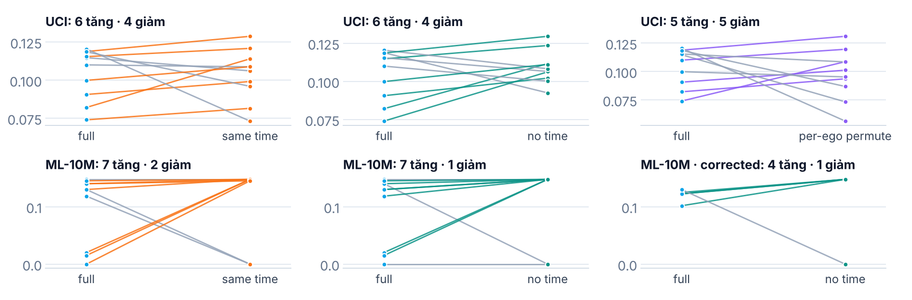

## Phụ lục B. Hidden dimension của baseline (slide 26)

NDCG@5 validation của TGAT và GraphMixer ở từng dimension (trung bình ± std trên 10 seed). Theo giao thức, mỗi seed huấn luyện cả 6 dimension rồi giữ bản tốt nhất.

| Mô hình · dataset | dim 16 | 32 | 64 | 128 | 256 | 512 (giờ/seed) |
|---|---:|---:|---:|---:|---:|---:|
| GraphMixer · ML-10M | 1,77 | 1,63 | 2,44 | 4,17 | 7,85 | 24,50 |
| TGAT · ML-10M | 1,87 | 1,71 | 1,85 | 1,96 | 1,70 | 1,71 |
| GraphMixer · UCI | 0,31 | 0,37 | 0,31 | 0,68 | 1,63 | 4,27 |
| TGAT · UCI | 0,24 | 0,20 | 0,28 | 0,25 | 0,30 | 0,32 |

- **Kết quả gần như phẳng theo dimension.** Chênh lệch giữa các dim phần lớn nằm trong sai số giữa seed.
- **Chi phí tăng mạnh theo dimension.** Với GraphMixer, dim lớn tốn thời gian nhiều hơn hẳn mà không cho điểm tốt hơn.
- **Validation lệch so với test.** Trên UCI, baseline chỉ đạt .015–.034 trên validation nhưng .05–.07 trên test, nên việc chọn dim theo validation khá nhiễu.

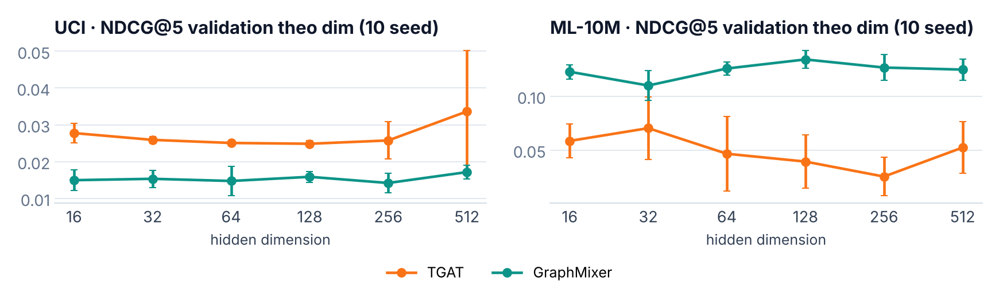
